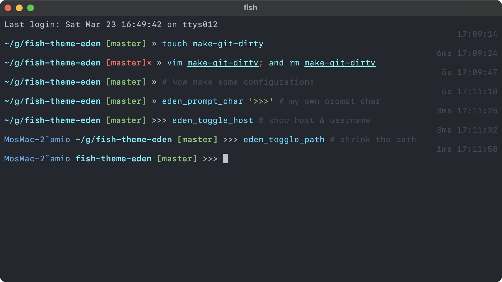

# Eden

A theme for [Fish](https://fishshell.com) with Git status and a right-aligned summary of the last command.

## Install

With [Oh My Fish](https://github.com/oh-my-fish/oh-my-fish):

```fish
omf install eden
```

Remove it with `omf remove eden`.

With [Fisher](https://github.com/jorgebucaran/fisher):

```fish
fisher install amio/fish-theme-eden
```

Remove it with `fisher remove amio/fish-theme-eden`.

## Features

- After each command, a line above the next prompt shows its completion time, duration, and nonzero exit status on the right.
- The left prompt starts on a new line directly below the command summary, or after a blank line when there is no summary. It shows the current directory and Git branch, with diff statistics for uncommitted changes.
- Linked Git worktrees use braces, for example `{feature}`, while the main checkout uses brackets, for example `[feature]`. A detached HEAD shows `detached@` followed by the short commit ID, for example `{detached@abc1234}` in a linked worktree or `[detached@abc1234]` in the main checkout. Clean Git labels are green; uncommitted changes turn them red and append statistics such as `+88-25`, with additions in green and deletions in red. Counts include staged, unstaged, and untracked files, using the net diff against HEAD for tracked files. Changes without text line differences, such as binary or empty files, show `+0-0`.
- `eden_toggle_path` switches between an abbreviated path with the last two directories shown in full and the current directory alone.
- `eden_toggle_diff_stats` shows or hides Git diff statistics for the current shell session. Statistics are shown by default; hiding them restores the red `×` dirty marker, for example `[feature]×`. To hide them in every new shell, add `set -g THEME_EDEN_HIDE_DIFF_STATS yes` to `~/.config/fish/config.fish`.
- `eden_toggle_host` shows or hides the host and user.
- `eden_prompt_char` sets a custom prompt character; run it without an argument to restore `»`.
- `eden_toggle_ssh_tag` shows or hides the `-SSH-` tag on SSH connections. The tag is red for root and blue otherwise.

Diff statistics use Myers and copy detection (`git diff --diff-algorithm=myers --find-copies HEAD`), matching Tig's default diff settings. This can differ from plain `git diff` when `diff.algorithm` is configured or files are copied. Tig shows staged and unstaged changes separately; Eden shows their net effect, plus untracked files. External diff helpers and text conversion are disabled. Large sets of untracked files are processed in a batch using a temporary index and object directory, leaving the repository's index and objects untouched.

## Screenshot



## Development

Run `fish --no-config tests/smoke.fish` to check prompt formatting and Git status detection.

## License

[MIT](LICENSE) © [Amio](https://github.com/amio)
